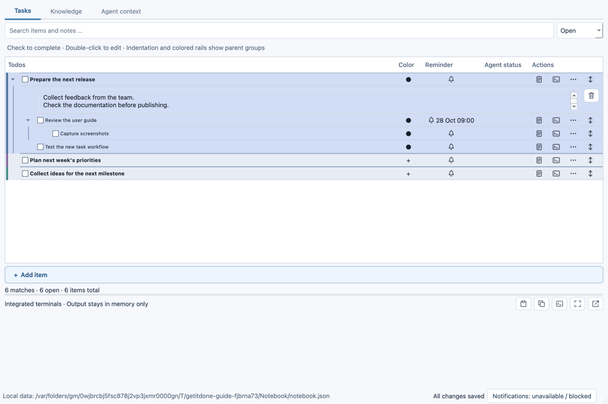
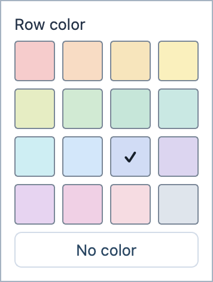
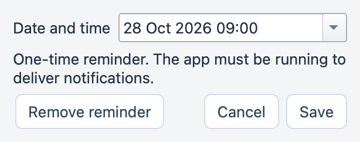
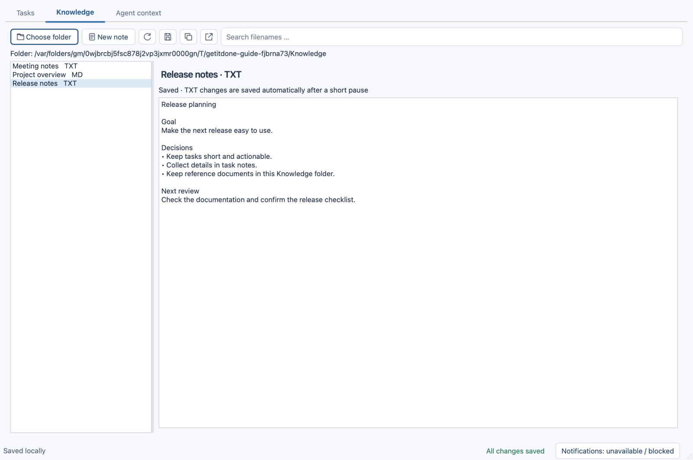
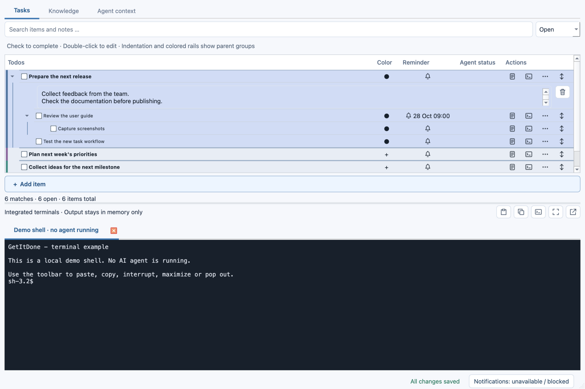

# GetItDone

**Organize tasks, capture ideas, and open coding agents right where the work belongs.**

GetItDone is your local work notebook for macOS and Windows. Break tasks into smaller steps, add notes and reminders, and keep reference documents close at hand. Your tasks and knowledge files stay on your computer. The notebook requires no account; connected coding agents need their own installation and sign-in.



The screenshots show the macOS interface with example data.

**File → Settings → Appearance** lets you switch between Light and the
Everforest dark theme. Save to apply it immediately to menus, dialogs, task colors
and integrated terminals; your choice is kept for the next launch.

## Canvas

The **Canvas** tab displays a freely editable local HTML page. Use **Open agent …**
at the bottom to choose an installed agent and work directly in the Canvas folder.
The agent terminal opens below the page; HTML and asset changes reload automatically.
Canvas terminals are live-only, not saved notebook sessions.

The folder is `canvas/` inside GetItDone's data directory and starts with
`canvas.html` and `AGENTS.md`. There is no required framework or build step.
Full manual and scheduled ZIP backups include **everything in this folder**.
Copy required images, CSS, JavaScript and data inside it and use relative paths:
files outside the folder and remote resources are not included by the Canvas backup.
Symlinks/junctions cause backups to fail rather than pulling in external files.
To restore, quit GetItDone and restore `canvas/` into the data directory.

## Getting started

Open **GetItDone**. On macOS, you can drag the app into Applications and launch it from there. On Windows, launch it from the Start menu after installation. If you have already set up the project locally, double-click **run.command** on your Mac to launch the current version.

Tasks appear first and can be edited immediately. Other tabs initialize when
opened; the embedded browser and PDF viewer are not loaded for a tasks-only
session. Reminders, scheduled jobs and backups remain active independently of
their tabs. Knowledge-folder discovery runs in the background.

Installers from successful builds are available as [GitHub Actions artifacts](https://github.com/oliverruoff/GetItDone/actions/workflows/build.yml). Open a successful run for your operating system and download the matching artifact; you may need to sign in to GitHub. For setup from source, see the [technical guide](docs/DEVELOPMENT.md).

### Installation by a coding agent (including `gid`)

The recommended setup is **one editable pipx installation**. It creates the `gid` command from `pyproject.toml` and connects it to a stable checkout. No shell alias, activated environment, administrator shell, or global `pip install` is needed. Use Python 3.12+ for this documented setup. The development extras include PyInstaller, which the macOS launcher needs to build its app bundle.

#### Agent checklist: inspect before changing anything

1. Check the OS, shell, Git and Python versions, and the intended checkout path. Reuse an existing checkout; inspect `git status --short` before updating it. Do not move it after an editable installation.
2. Find **all** existing commands named `gid`: `Get-Command gid -All` and `where.exe gid` in PowerShell; `type -a gid` in bash/zsh; `type -a gid` in fish. Inspect any existing script before replacing it. An old alias, function, `gid.cmd`, or another installation can shadow the correct command.
3. Choose **pipx or the `.venv` wrapper below**, not both. Check `pipx list` (Windows: `py -m pipx list`) before installing. Preserve working launchers and unrelated PATH entries. Obtain permission before installing system prerequisites or replacing another command.
4. Verify from a **new terminal and a directory outside the checkout**, including a second launch. Do not declare success just because installation finished.

#### Recommended: macOS

With Homebrew already installed, install the prerequisites if missing:

```sh
brew install git python@3.12 pipx
mkdir -p "$HOME/Documents/develop"
git clone https://github.com/oliverruoff/GetItDone.git "$HOME/Documents/develop/GetItDone"
cd "$HOME/Documents/develop/GetItDone"
pipx ensurepath
pipx install --python "$(brew --prefix python@3.12)/bin/python3.12" --editable '.[dev]'
```

Skip cloning if this checkout already exists. Close and reopen Terminal/iTerm after `ensurepath`. The first launch builds the notification-capable app bundle; subsequent launches reuse it. These commands are bash/zsh syntax; fish users can perform installation in `bash`, then run `gid` from fish after restarting it.

#### Recommended: Windows

Use a normal **PowerShell** session with Git and Python 3.12+ installed. The following selects Python 3.12 explicitly; adjust the selector if using another supported version:

```powershell
py -3.12 -m pip install --user pipx
New-Item -ItemType Directory -Force "$HOME\Documents\develop" | Out-Null
git clone https://github.com/oliverruoff/GetItDone.git "$HOME\Documents\develop\GetItDone"
Set-Location "$HOME\Documents\develop\GetItDone"
py -3.12 -m pipx ensurepath
py -3.12 -m pipx install --python (py -3.12 -c "import sys; print(sys.executable)") --editable ".[dev]"
```

Skip cloning an existing checkout. **Close the entire terminal application and reopen it** so the new user PATH is inherited; opening another tab in an old Windows Terminal may retain the old PATH. Run `Get-Command gid -All` again: the selected command must belong to this setup, not an older wrapper or PowerShell function. The installed console command is `gid.exe`; the GUI entry point is `getitdone.exe`.

#### Recommended: Linux (source setup; desktop support is experimental)

Use a graphical desktop session, not a headless server. Install Git, Python 3.12+, venv support and pipx with your distribution's package manager, with permission for system changes. For example, **Ubuntu 24.04** provides these prerequisites:

```sh
sudo apt-get update
sudo apt-get install git python3 python3-venv pipx
python3 --version
mkdir -p "$HOME/Documents/develop"
git clone https://github.com/oliverruoff/GetItDone.git "$HOME/Documents/develop/GetItDone"
cd "$HOME/Documents/develop/GetItDone"
pipx ensurepath
pipx install --python python3 --editable '.[dev]'
```

Skip cloning an existing checkout. Older distributions may need a separate Python 3.12+ installation; do not replace their system Python. Qt also needs your distribution's graphical runtime libraries. If startup reports a missing Qt platform plugin/library, diagnose that dependency rather than setting `QT_QPA_PLATFORM=offscreen` for normal use. Linux desktop, terminal and notification behavior is **not covered by the macOS/Windows support guarantee**. WSL is a separate installation and requires a working graphical environment (for example WSLg).

#### Alternative: reuse a local `.venv` with a persistent launcher

Use this instead of pipx if an agent has already installed the checkout into `.venv`. Refresh that environment with its own Python; never require users to activate it each time:

```powershell
# Windows, from the checkout; create the environment only if missing.
py -3.12 -m venv .venv
.\.venv\Scripts\python.exe -m pip install --editable ".[dev]"
```

```sh
# macOS / Linux, from the checkout; select an installed Python 3.12+.
python3.12 -m venv .venv
.venv/bin/python -m pip install --editable '.[dev]'
```

**Windows launcher:** the following PowerShell example creates a user-local `gid.cmd`, adds only its directory to the user PATH, and leaves existing PATH entries intact. Adjust `$repo` to the actual checkout. First resolve any conflicting command from the checklist; do not overwrite someone else's launcher.

```powershell
$repo = (Resolve-Path "$HOME\Documents\develop\GetItDone").Path
$bin = Join-Path $env:LOCALAPPDATA "GetItDone\bin"
$launcher = Join-Path $bin "gid.cmd"
if (Test-Path $launcher) { throw "Inspect the existing launcher before updating it: $launcher" }
if (-not (Test-Path "$repo\.venv\Scripts\getitdone.exe")) { throw "Install the checkout into .venv first" }
New-Item -ItemType Directory -Force $bin | Out-Null
$content = @'
@echo off
chcp 65001 >nul
if not exist "__CHECKOUT__\.venv\Scripts\getitdone.exe" (
    echo GetItDone installation not found. Check the checkout and .venv.
    exit /b 1
)
start "" /D "__CHECKOUT__" "__CHECKOUT__\.venv\Scripts\getitdone.exe" %*
'@
$content = $content.Replace('__CHECKOUT__', $repo)
[IO.File]::WriteAllText($launcher, $content, (New-Object Text.UTF8Encoding($false)))
$userPath = [Environment]::GetEnvironmentVariable("Path", "User")
if (($userPath -split ';') -notcontains $bin) {
    [Environment]::SetEnvironmentVariable("Path", "$bin;$userPath", "User")
}
$env:Path = "$bin;$env:Path"
```

`start ""` is intentional: the empty first quoted argument is the window title, not the executable. Quoting both paths supports spaces. `%*` forwards arguments such as `--data-dir`; `/D` sets a predictable working directory. This starts the GUI without keeping PowerShell occupied. The script writes UTF-8 without a BOM and selects code page 65001, including on Windows PowerShell 5.1, so non-ASCII checkout paths are supported.

**macOS / Linux launcher:** create `~/.local/bin/gid` with the following contents, adapting `REPO` if necessary. Do not overwrite an existing file without inspecting it:

```sh
#!/bin/sh
REPO="$HOME/Documents/develop/GetItDone"
if [ ! -x "$REPO/.venv/bin/gid" ]; then
    echo "GetItDone installation not found; check the checkout and .venv." >&2
    exit 1
fi
cd "$REPO" || exit 1
exec "$REPO/.venv/bin/gid" "$@"
```

Create `~/.local/bin` if missing and run `chmod +x ~/.local/bin/gid`. If it is not already on PATH, add `export PATH="$HOME/.local/bin:$PATH"` once to the appropriate bash/zsh startup file; for fish use `fish_add_path "$HOME/.local/bin"`. Never replace the entire PATH. The wrapper must call the **absolute environment entry point**, not bare `gid` (which would recurse). macOS launches its bundle; on Linux the foreground command stays attached to the desktop process until it exits.

#### Verification and troubleshooting (all setups)

- In a fresh shell, verify resolution: `Get-Command gid -All` / `where.exe gid` on Windows, or `type -a gid` on macOS/Linux. Compare the path to the chosen pipx installation or wrapper. For wrappers, use the underlying environment entry point for `--version`: the detached Windows wrapper does not return console output.
- Run `gid` **outside the repository**. The notebook must open without environment activation. Check the build revision in its title, then run `gid` again: the same notebook should be activated, with no automatic shutdown or second instance.
- Closing the main window can leave the notebook running in the tray. To load updates, use **File → Quit**, wait for shutdown, then run `gid` again. `gid --replace-running` explicitly requests a safe restart and confirmation before stopping active agents; do not make it the default launcher behavior.
- If a start reports that the previous instance has not finished shutting down, do not repeatedly launch copies, delete `instance.lock`, or kill every Python process. Inspect the existing instance and preserve its data. Any forced shutdown needs explicit approval because unsaved edits and running agents may be lost.
- If `gid` is missing, fix the user PATH or the selected environment's installation. If it selects old code, inspect shadowing commands and editable-install paths before reinstalling. Do not use `pipx --force`, delete environments, or overwrite shell profiles blindly.

Agent CLIs such as OpenCode need their own installation and sign-in. The packaged Windows installer does not install Python or `gid`. The Windows wrapper and repeated-launch behavior have been tested locally; macOS/Linux commands are setup guidance, not a claim that those fresh installations were tested here.

### Updates by a coding agent

1. Quit with **File → Quit**. Back up the data folder shown in Settings and the separate Knowledge folder.
2. In the original clone, inspect `git status --short`, the current branch and its upstream. Preserve local changes; never reset, clean, or overwrite them to update.
3. Run `git pull --ff-only` on the intended branch. Stop and ask if history diverges or local changes conflict.
4. From the checkout, refresh dependencies with `pipx runpip getitdone-notebook install --editable '.[dev]'` on macOS, or `py -m pipx runpip getitdone-notebook install --editable ".[dev]"` on Windows.
5. Run `gid` and check the build revision in the title. macOS rebuilds a stale bundle automatically; Windows source launches use the updated checkout.

For a `.venv` setup instead of pipx, use its Python for `-m pip install -e ".[dev]"` and the tests/build commands in the technical guide. Installed binaries require a new platform build/installer; pulling source alone does **not** update an installed executable. Do not delete notebook data during updates.

To create your first tasks:

1. In the **Tasks** tab, click **+ Add item** at the bottom.
2. Type a task. Press **Enter** to save the text and finish editing without creating another task.
3. Open **… → + Add child item** on a task to break it into smaller steps.
4. Add a note, color, or reminder as needed.
5. Tick the checkbox when the task is complete.

Tasks with direct subtasks show their count at the right edge of the title. Tasks without subtasks show no count; notes and agent sessions are not counted. Normal task titles have no hover tooltip.

The row-color palette uses slightly stronger, still-soft shades. Existing standard palette assignments use the updated shades automatically; saved category names, IDs and custom colors stay unchanged.

Changes are saved automatically. **All changes saved** at the bottom confirms that your current work has been saved.

Paste multiline text into a task title to create one todo per nonempty line at the same level. An empty title receives the first line; otherwise the new todos follow the current task. Task notes keep normal multiline paste behavior.

## Editing and organizing tasks

**Double-click the text** to edit it directly in the row. Alternatively, click a task and press **F2**. Long titles wrap automatically, and each row grows to show the full text, including line breaks. Row heights adjust when you resize the window. **Escape** discards an empty new task; existing task edits are saved.

Long hyperlinks show the first 20 and last 20 characters, separated by `...`. Left-click opens the complete URL; right-click copies it to the clipboard with a brief confirmation. The original text remains available when editing or hovering over the task.

To move a task, drag it to its new position:

A highlighted placeholder makes room at the prospective drop position while you hold the task. Dropping onto a task shows an indented child preview; dropping near a row's top or bottom edge inserts a sibling.

- **Drop between two rows:** Insert the task at that position. The insertion marker shows where it will go.
- **Drop onto another task:** Make the dragged task a subtask of that task.
- **Drop in the empty list area below the last task:** Move the task to the end of the top level.

Existing subtasks move with their parent. You can also use **… → Indent / Outdent**, or change the order with **Move up / Move down**. Click the small triangle on the left to collapse or expand a group. A single click on a row sets the target for keyboard actions without drawing an extra selection outline.

Use the search field to find tasks by their titles or notes. The filter on the right switches between **Open**, **Completed**, and **All**. Parent tasks may remain visible to provide context for a search result.

### Task row controls

Hover over an icon to see its tooltip.

| Control | What it does |
| --- | --- |
| Checkbox on the left | Complete or reopen a task |
| **+ / color dot** in the **Color** column | Choose or remove a row color |
| Bell under **Reminder** | Create, change, or remove a reminder |
| Note icon on the right | Open and edit a note directly below the task |
| Terminal icon on the right | Create a coding-agent session for this task |
| Copy icon | Copy only this task's original title text |
| Hierarchy-copy icon | Copy this task and all subtasks as an indented list, including collapsed/completed subtasks |
| Trash icon on the far right | Delete the task; deleting subtasks or session links asks for confirmation |
| **…** | More actions, such as adding a subtask |

## Using colors and notes

Click the plus or color dot in the **Color** column. Choose one of **16 pastel colors** to color the row immediately. **No color** clears the assignment. Subtasks keep their own colors. Existing custom colors are preserved.



The note icon opens a text field directly below the task. Use it for details, questions, or results. Your text is saved automatically. The trash icon next to the note deletes its contents; you can then restore them with **Undo**.

## Completing tasks and undoing changes

Tick the checkbox on the left. Completed tasks stay visible with a crossed-out title in **Open**; you have five seconds to reverse the action with **Undo**, or can clear the checkbox later. Click **Cleanup** beside the filter to hide completed tasks from Open. Cleanup does **not** delete tasks, notes or session links: they remain under **Completed** and **All**, even after restarting. Reopening a task returns it to Open; completing it again keeps it visible until the next Cleanup.

**Completing a parent task also completes its subtasks.** Undo restores their previous completion states. Reopening a subtask also reopens its parent tasks.

## Setting reminders

1. Click the task's bell in **Reminder**.
2. Choose a date and time in your local time zone.
3. Click **Save**. The scheduled time appears directly in the row.



Click the bell again to change the reminder. **Remove reminder** clears it.

Use **In 15 min**, **In 1 hour**, or **Tomorrow 09:00** for a quick reminder. For a custom time, choose the date from the calendar and select or type the hour and minute separately (24-hour clock). The minute dropdown offers five-minute steps; you can type any exact minute. A preview confirms the selected day and time before you save.

GetItDone must be running to deliver a notification. It can keep running in the background with the main window closed. If the app was fully closed at the scheduled time, the reminder is shown as overdue on the next launch; a notification is not delivered retroactively.

Use **Help → Test notification** to check delivery. The notification status at the bottom of the window opens guidance and settings. Allow GetItDone notifications in your system settings; focus modes can suppress banners.

On Windows, GetItDone registers its own notification identity and uses native Notification Center toasts rather than tray balloons. Start the updated app and send a test notification, then open **Settings → System → Notifications → GetItDone** and enable notifications and banners. Windows may not list a sender until its first notification. If missing, check the in-app notification status for registration/dependency errors, and reinstall the current installer or refresh source dependencies. Check global notifications, Do Not Disturb and organizational policies too. GetItDone cannot override a denied system setting.

Some Windows source installations report “Element not found” when querying notification settings even though sending works; GetItDone still attempts native delivery in that specific case. Explicitly disabled settings and other errors remain visible. Failed reminders are retried after one minute while the app keeps running, without sending a notification every second. A successful submission confirms OS acceptance, not that focus mode allowed a banner.

## Keeping knowledge and documents close at hand

The **Knowledge** tab works with files from a local folder.



1. Click **Choose folder** and select your knowledge folder.
2. Select a file on the left. Use the search field to filter filenames.
3. Click **New note** to create a text note. Its title becomes the filename.

| File type | What you can do in GetItDone |
| --- | --- |
| TXT | Read and edit; changes are saved automatically after a short typing pause |
| Markdown | Edit source text; changes are saved automatically |
| Word (.docx) | Read text and tables; the layout may differ from Word |
| PDF | View pages directly in the app |

The list shows files directly inside the selected folder, without searching subfolders. New notes are saved as real `.txt` files that you can also open in other applications. **Open externally** opens a file in its associated application.

Use the sort selector for **Name · A–Z** or **Modified · newest first**. Edit a TXT/Markdown title directly above the right-hand editor and press Enter or leave the field to rename the file. Existing filenames are never deliberately overwritten. **Delete file** asks for confirmation before permanently deleting the selected file from disk (not the recycle bin).

If a text file changes outside GetItDone while you are editing it, saving stops and your text stays in the editor. Use **Save as new note** to preserve your text in a separate file. **Refresh** lets you reload the external version after discarding local changes.

## Opening coding agents for tasks

You can use **OpenCode, Codex, Claude Code, or pi** in integrated terminals. Install your chosen agent separately and sign in to it first. Its own account requirements, permissions, and any usage costs apply.

1. Click the **New session** terminal icon on a task.
2. Choose the agent and the working folder where it should operate.
3. Confirm with **New session**.
4. The task text is copied to your clipboard. Paste it into the terminal and submit it yourself.

The linked session appears below the task. **Resume** opens its running terminal or resumes the saved session when its session ID is available. The note icon (**Last reply**) opens the latest captured assistant text directly from the notebook, without starting the agent. Replies and their unread state survive app restarts; a later reply replaces the previous one. Click **New agent message** in the status column to read it. New replies observed while the app is inactive can send a system notification. Initial history imports are quiet. Codex, Claude and pi replies are read from exact local session histories; OpenCode uses its local API. Custom profiles have no automatic reply capture. Missing histories or unavailable APIs preserve the previously saved reply.

The info icon opens details such as the working folder and session ID. If an older session has no ID, it can only be resumed once the ID has been found or entered in its details.



*This screenshot uses a local demo shell. No coding agent is running.*

The toolbar above the terminals provides these controls, from left to right:

| Icon / tooltip | Function |
| --- | --- |
| **Paste** | Paste text from the clipboard |
| **Copy selection** | Copy selected terminal text |
| **Send Ctrl+C** | Send Ctrl+C to the running process |
| **Maximize / Restore** | Expand the terminal area or show tasks again |
| **Pop out / Dock** | Move terminals into a separate window or dock them again |

Closing the separate window docks the terminals back into the main window. Use **View → Terminal panel** to show or hide the panel. Terminal history is kept only while the app is running and is not restored after a restart.

Use the scrollbar/wheel for terminal history, or **Shift+PageUp / Shift+PageDown** and **Shift+wheel** to scroll without sending those actions to the agent. Full-screen agents can use an alternate screen with no shell scrollback; their own conversation scrolling remains agent-controlled. Maximizing, docking and popping out automatically resize the terminal grid.

In **Agent context**, you can inspect discovered **Skills**, **MCPs**, and **Instructions** for an agent and working folder, even without a running session. This view shows discovered or configured entries; it does not confirm that an agent has loaded or activated them in a particular conversation.

## Useful keyboard shortcuts

Click the task you want to work with first. These shortcuts apply in the task list, not while typing in a multiline note.

| Key | Action |
| --- | --- |
| **Enter** | Finish editing; when not editing, create the next task at the same level |
| **F2** | Edit the task title |
| **Tab** | Indent the task |
| **Shift + Tab** | Outdent the task |
| **Alt + ↑ / ↓** | Move the task within its level |

## Fast capture and scheduled tasks

From any tab (or a popped-out terminal), **Command+T** on macOS / **Ctrl+T** on Windows adds a parent todo at the bottom and focuses its text. **Command/Ctrl+N** opens Knowledge and a new note with the cursor in its content. The editable title defaults to `Note_YYYY-MM-DD_HH-MM`; select `.txt` (default) or `.md`. **Enter** saves the new note; **Shift+Enter** inserts a line break. See **Help → Keyboard shortcuts** for the complete list.

Use the expand/collapse icon beside the task filter to expand or collapse everything. New tasks start **collapsed**. Individual expansion states and full-title/note visibility save immediately. Expanded items contain a **+** row for adding children; the entire row is clickable. Collapsed parents occupy one row. Opening a note expands its task so the editor is immediately visible.

The fourth tab, **Scheduled tasks**, manages one-time and recurring agent runs. Choose the prompt, agent, working folder, local date/time and an interval in minutes, hours, days, weeks or months. Use **+ New scheduled task** below the schedule list to create a job. Each schedule shows its state, next date and run count. Select it to edit, run now, pause or delete it. The **Run history** table lists every execution with its number, local start/end times, duration and status, alongside total/success/failure counts. Select any run to read or copy its own saved output below. Task details show the current prompt/folder; **Run details** shows the original prompt/folder used for that execution. Reading output does not start the agent. **Schedule again** opens the date editor for a finished one-time job. Codex replies are displayed as text; select **Raw process output** for diagnostics. Each run retains the last 1 MB of output locally, including across restarts. Ordinary interactive terminal output still remains in memory only.

Schedules run while GetItDone is open, including when hidden in the menu bar or tray. After reopening, a missed schedule runs once; recurring schedules advance to the next future date without replaying every missed occurrence. A run interrupted by an app crash is marked accordingly and is not automatically repeated. Sign in to the selected agent CLI first. Custom profiles must supply noninteractive arguments; their prompt is appended as one argument. Runs use the CLI's configured permissions and may fail if an interactive permission request is required.

## Agent executions

The **Agent executions** tab combines interactive sessions launched from Tasks and every scheduled run. The clickable counter in the bottom bar is visible from every tab and shows running processes, including the scheduled count. Tab labels show the active counts too. Open terminals may be idle; their agent state is shown separately when available.

Use **All executions**, **Running**, or **History** to filter the list. Each entry shows its origin, start/end times and state. Interactive process launches, including resumes, are saved as separate history entries. Older session links remain visible as **Saved session** without an invented outcome. Processes left marked running after an app interruption are marked **Interrupted** on reopening.

Select an entry to read its saved output. Scheduled runs retain their inbox output; interactive executions retain the last assistant reply captured for that launch, rather than a terminal transcript. **Focus terminal** opens an existing interactive process. **View live output** follows a running scheduled job without starting another agent. Completed entries offer **Resume session** when a session link is available; the native history, CLI and working folder are still required to resume. **View scheduled run** selects the exact run in Scheduled tasks. Reading stored output needs no running agent.

## Closing, saving, and backing up

**Closing the window** keeps GetItDone running in the background in the menu bar or system tray, so reminders and running sessions remain available. If no system tray is available, the window stays minimized. Use **File → Quit** to exit completely; the app asks before stopping running sessions.

Enable **Settings → Startup → Start GetItDone when I sign in** for automatic launch after login. Disable the same checkbox to remove it. Startup uses the current installation path; after moving the app, disable/re-enable the option from its new location. This starts after user login, not before login as a system service.

Tasks, task notes, colors, reminders, and session links are stored locally. **Settings** shows the exact storage location. Knowledge files remain separate in the folder you selected. There is no automatic synchronization between computers.

Every save writes and flushes a temporary file before atomically replacing `notebook.json`. The app keeps up to three backup generations alongside it: `notebook.backup.json`, `notebook.backup.2.json`, and `notebook.backup.3.json`. The first save also creates a backup; unchanged saves do not rotate history. On macOS/Linux the containing directory is flushed too.

Short Windows access/sharing locks (for example from antivirus or indexing) are retried up to six times, with less than a second of total delay per file. Persistent failures still show a save error and keep your edits in memory. External changes are checked again before each main-file replacement attempt; no permissions are changed and the existing file is never deleted to bypass a lock.

If the main file is missing or damaged, the app recovers the newest valid backup and displays a warning: changes after that backup may be missing. A damaged original is preserved as `notebook.damaged-<unique-id>.json`. If no valid backup exists, opening stops without creating an empty replacement. Files from an unsupported notebook version are preserved without automatic downgrade. If another program changes or deletes the notebook while it is open, saving stops and your edits remain in memory; preserve the data folder before reopening.

To transfer a notebook, quit the app on both computers and copy the data folder. Saved agent links do not require the original agent installations or histories to open the notebook. Resume still needs the matching native history, agent, and working directory on that computer; you can create new sessions locally. Knowledge files remain separate and must be copied too.

For an independent backup, quit the app and back up both the data folder shown in **Settings** and your knowledge folder to another disk or backup service. Adjacent backups protect against interrupted saves and individual damaged files, but cannot protect against disk failure or deletion of the entire folder. If a save error appears at the bottom of the window, resolve it before relying on the saved data.

### Automatic full backups

Open **File → Settings → Backups**, select **Enable automatic full backups**, choose a local time, an interval (**every N days, weeks or months**) and a destination folder, then **Save**. For daily backups, choose **Every 1 day**. The destination must be outside the notebook data and Knowledge folders; a missing destination folder is created at backup time.

The default destination is **Documents/GetItDone/Backups** (using your system's Documents location). An existing custom destination is kept. Click **Backup now** to create a full backup immediately in the folder currently shown, even when automatic backups are disabled. This does not change the automatic schedule or apply other unsaved settings. The button is disabled while a backup is running; manual errors are displayed without starting automatic retries.

After each successful manual or scheduled full backup, GetItDone sends a brief system notification, also while the window is hidden. System notification permissions and Focus / Do Not Disturb settings may suppress the banner.

The first backup runs at the next selected time (today or tomorrow), then repeats at the chosen interval. **GetItDone must be running**, including hidden in the tray/menu bar. After sleep or a fully closed app, one missed backup is caught up when the app runs again; it does not create an archive for every missed day. Enable startup at login if desired. Backup failures are shown in the bottom bar and **Settings → Backups**, and retried after five minutes without skipping the missed backup.

Each backup is a separate, dated `GetItDone-….zip` with all tasks (including completed tasks and subtasks), notes, reminders, colors/categories, settings, session links, saved replies, execution history, scheduled jobs and **all files and subfolders in Knowledge**. Existing edits are saved first; unreadable or changing files cause a visible failure rather than a silently incomplete ZIP. Knowledge symlinks/junctions must be backed up separately; their presence blocks the full backup. External agent projects, credentials and native chat histories are not included. ZIP files are **not encrypted**. Older backups are never automatically deleted, so monitor free space and use another disk or a backed-up folder for disk-failure protection.

**Restore:** quit GetItDone and preserve your current data first. Extract the ZIP's `notebook.json` into the data folder shown in Settings, and restore `knowledge/` into your Knowledge folder. Original paths are recorded in `manifest.json`; if the Knowledge path changed, select the restored folder in the app. Each ZIP also contains `RESTORE.txt` with these instructions.

## Troubleshooting

| Problem | What to check |
| --- | --- |
| A task has disappeared | Clear the search, set the filter to **All**, and expand collapsed groups |
| No notification appears | Keep the app running, use **Help → Test notification**, and check system permissions and focus mode |
| An agent is missing or will not start | Check the agent's installation and sign-in, and the selected working folder |
| Resume reports a missing ID | Open the session details; the original conversation cannot be reliably resumed without its matching ID |
| A file cannot be edited | Knowledge edits TXT and Markdown; use **Open externally** for Word/PDF |
| Launching the app again does not open a new window | GetItDone normally activates the existing instance |

For technical setup, tests, and builds, see the [developer documentation](docs/DEVELOPMENT.md). For verified platform limitations, see [validation notes](VALIDATION.md).
