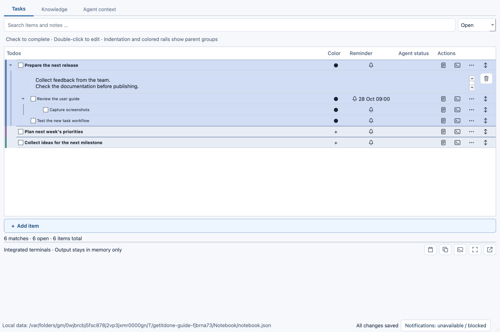
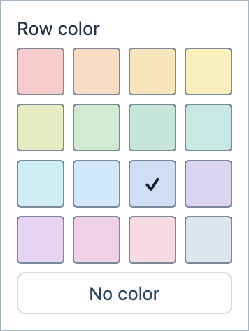
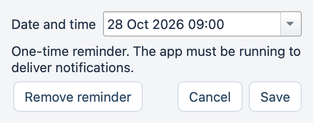
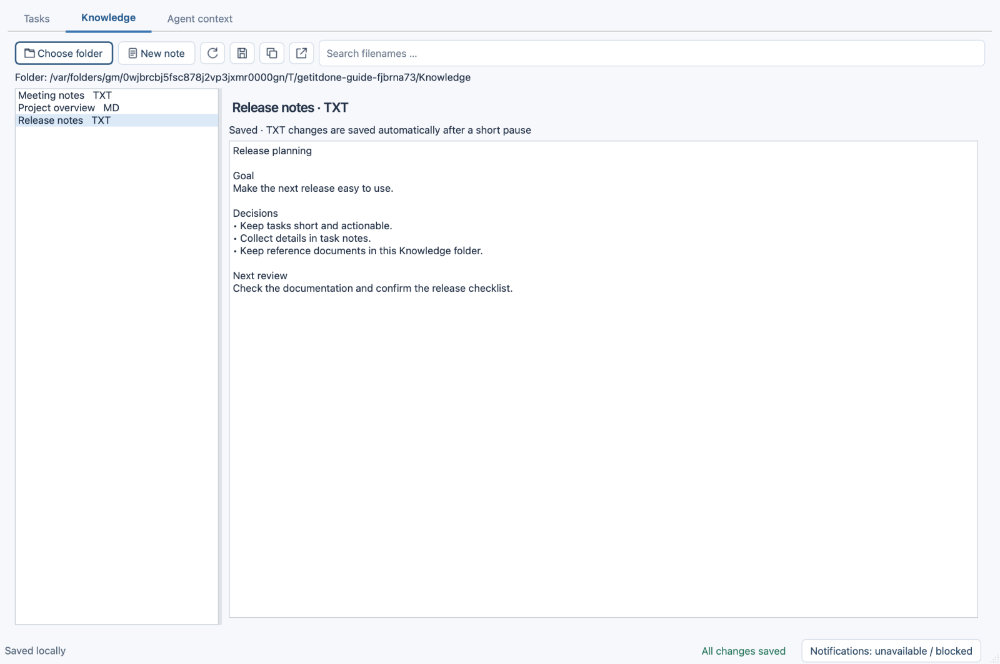
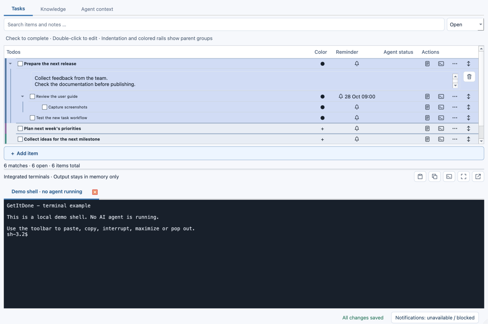

# GetItDone

**Organize tasks, capture ideas, and open coding agents right where the work belongs.**

GetItDone is your local work notebook for macOS and Windows. Break tasks into smaller steps, add notes and reminders, and keep reference documents close at hand. Your tasks and knowledge files stay on your computer. The notebook requires no account; connected coding agents need their own installation and sign-in.

The screenshots show the macOS interface with example data.

## Getting started

Open **GetItDone**. On macOS, you can drag the app into Applications and launch it from there. On Windows, launch it from the Start menu after installation. If you have already set up the project locally, double-click **run.command** on your Mac to launch the current version.

Installers from successful builds are available as [GitHub Actions artifacts](https://github.com/oliverruoff/GetItDone/actions/workflows/build.yml). Open a successful run for your operating system and download the matching artifact; you may need to sign in to GitHub. For setup from source, see the [technical guide](docs/DEVELOPMENT.md).

To create your first tasks:

1. In the **Tasks** tab, click **+ Add item** at the bottom.
2. Type a task. Press **Enter** to create the next task at the same level.
3. Open **… → + Add child item** on a task to break it into smaller steps.
4. Add a note, color, or reminder as needed.
5. Tick the checkbox when the task is complete.

Changes are saved automatically. **All changes saved** at the bottom confirms that your current work has been saved.

## Editing and organizing tasks

**Double-click the text** to edit it directly in the row. Alternatively, click a task and press **F2**. For long titles, the vertical arrows icon reveals the full text; expanded titles support multiline editing with **Shift+Enter**. **Escape** discards an empty new task; existing task edits are saved.

To move a task, drag it to its new position:

- **Drop between two rows:** Insert the task at that position. The insertion marker shows where it will go.
- **Drop onto another task:** Make the dragged task a subtask of that task.
- **Drop in the empty list area below the last task:** Move the task to the end of the top level.

Existing subtasks move with their parent. You can also use **… → Indent / Outdent**, or change the order with **Move up / Move down**. Click the small triangle on the left to collapse or expand a group. A single click on a row sets the target for keyboard actions without drawing an extra selection outline.

Use the search field to find tasks by their titles or notes. The filter on the right switches between **Open**, **Completed**, and **All**. Parent tasks may remain visible to provide context for a search result.

### Task row controls

Hover over an icon to see its tooltip.

| Control | What it does |
| --- | --- |
| Checkbox on the left | Complete or reopen a task |
| **+ / color dot** in the **Color** column | Choose or remove a row color |
| Bell under **Reminder** | Create, change, or remove a reminder |
| Note icon on the right | Open and edit a note directly below the task |
| Terminal icon on the right | Create a coding-agent session for this task |
| **…** | More actions, such as adding a subtask or deleting the task |
| Vertical arrows on the right | Expand a long task title or collapse it again |

## Using colors and notes

Click the plus or color dot in the **Color** column. Choose one of **16 pastel colors** to color the row immediately. **No color** clears the assignment. Subtasks keep their own colors. Existing custom colors are preserved.

The note icon opens a text field directly below the task. Use it for details, questions, or results. Your text is saved automatically. The trash icon next to the note deletes its contents; you can then restore them with **Undo**.

## Completing tasks and undoing changes

Tick the checkbox on the left. In the **Open** view, the completed task disappears; you have five seconds to reverse the action with **Undo**. Later, you can find it under **Completed** or **All** and clear its checkbox.

**Completing a parent task also completes its subtasks.** Undo restores their previous completion states. Reopening a subtask also reopens its parent tasks.

## Setting reminders

1. Click the task's bell in **Reminder**.
2. Choose a date and time in your local time zone.
3. Click **Save**. The scheduled time appears directly in the row.

Click the bell again to change the reminder. **Remove reminder** clears it.

GetItDone must be running to deliver a notification. It can keep running in the background with the main window closed. If the app was fully closed at the scheduled time, the reminder is shown as overdue on the next launch; a notification is not delivered retroactively.

Use **Help → Test notification** to check delivery. The notification status at the bottom of the window opens guidance and settings. Allow GetItDone notifications in your system settings; focus modes can suppress banners.

## Keeping knowledge and documents close at hand

The **Knowledge** tab works with files from a local folder.

1. Click **Choose folder** and select your knowledge folder.
2. Select a file on the left. Use the search field to filter filenames.
3. Click **New note** to create a text note. Its title becomes the filename.

| File type | What you can do in GetItDone |
| --- | --- |
| TXT | Read and edit; changes are saved automatically after a short typing pause |
| Markdown | Read in a formatted view |
| Word (.docx) | Read text and tables; the layout may differ from Word |
| PDF | View pages directly in the app |

The list shows files directly inside the selected folder, without searching subfolders. New notes are saved as real `.txt` files that you can also open in other applications. **Open externally** opens a file in its associated application.

If a text file changes outside GetItDone while you are editing it, saving stops and your text stays in the editor. Use **Save as new note** to preserve your text in a separate file. **Refresh** lets you reload the external version after discarding local changes.

## Opening coding agents for tasks

You can use **OpenCode, Codex, Claude Code, or pi** in integrated terminals. Install your chosen agent separately and sign in to it first. Its own account requirements, permissions, and any usage costs apply.

1. Click the **New session** terminal icon on a task.
2. Choose the agent and the working folder where it should operate.
3. Confirm with **New session**.
4. The task text is copied to your clipboard. Paste it into the terminal and submit it yourself.

The linked session appears below the task. **Resume** opens its running terminal or resumes the saved session when its session ID is available. The note icon (**Last reply**) opens the latest captured assistant text directly from the notebook, without starting the agent. Replies and their unread state survive app restarts; a later reply replaces the previous one. Click **New agent message** in the status column to read it. New replies observed while the app is inactive can send a system notification. Initial history imports are quiet. Codex, Claude and pi replies are read from exact local session histories; OpenCode uses its local API. Custom profiles have no automatic reply capture. Missing histories or unavailable APIs preserve the previously saved reply.

The info icon opens details such as the working folder and session ID. If an older session has no ID, it can only be resumed once the ID has been found or entered in its details.

*This screenshot uses a local demo shell. No coding agent is running.*

The toolbar above the terminals provides these controls, from left to right:

| Icon / tooltip | Function |
| --- | --- |
| **Paste** | Paste text from the clipboard |
| **Copy selection** | Copy selected terminal text |
| **Send Ctrl+C** | Send Ctrl+C to the running process |
| **Maximize / Restore** | Expand the terminal area or show tasks again |
| **Pop out / Dock** | Move terminals into a separate window or dock them again |

Closing the separate window docks the terminals back into the main window. Use **View → Terminal panel** to show or hide the panel. Terminal history is kept only while the app is running and is not restored after a restart.

In **Agent context**, you can inspect discovered **Skills**, **MCPs**, and **Instructions** for an agent and working folder, even without a running session. This view shows discovered or configured entries; it does not confirm that an agent has loaded or activated them in a particular conversation.

## Useful keyboard shortcuts

Click the task you want to work with first. These shortcuts apply in the task list, not while typing in a multiline note.

| Key | Action |
| --- | --- |
| **Enter** | Create the next task at the same level |
| **F2** | Edit the task title |
| **Tab** | Indent the task |
| **Shift + Tab** | Outdent the task |
| **Alt + ↑ / ↓** | Move the task within its level |

## Fast capture and scheduled tasks

From any tab (or a popped-out terminal), **Command+T** on macOS / **Ctrl+T** on Windows adds a parent todo at the bottom and focuses its text. **Command/Ctrl+N** opens Knowledge and a new note with the cursor in its content. The editable title defaults to `Note_YYYY-MM-DD_HH-MM`; select `.txt` (default) or `.md`. **Enter** saves the new note; **Shift+Enter** inserts a line break. See **Help → Keyboard shortcuts** for the complete list.

Use the two icon buttons beside the task filter to expand or collapse everything. Individual expansion states and full-title/note visibility save immediately. Expanded items contain a compact **+** for adding children; collapsed parents occupy one row.

The fourth tab, **Scheduled tasks**, manages one-time and recurring agent runs. Choose the prompt, agent, working folder, local date/time and an interval in minutes, hours, days, weeks or months. Use **+ New scheduled task** below the schedule list to create a job. Each schedule shows its state, next date and run count. Select it to edit, run now, pause or delete it. The **Run history** table lists every execution with its number, local start/end times, duration and status, alongside total/success/failure counts. Select any run to read or copy its own saved output below. Task details show the current prompt/folder; **Run details** shows the original prompt/folder used for that execution. Reading output does not start the agent. **Schedule again** opens the date editor for a finished one-time job. Codex replies are displayed as text; select **Raw process output** for diagnostics. Each run retains the last 1 MB of output locally, including across restarts. Ordinary interactive terminal output still remains in memory only.

Schedules run while GetItDone is open, including when hidden in the menu bar or tray. After reopening, a missed schedule runs once; recurring schedules advance to the next future date without replaying every missed occurrence. A run interrupted by an app crash is marked accordingly and is not automatically repeated. Sign in to the selected agent CLI first. Custom profiles must supply noninteractive arguments; their prompt is appended as one argument. Runs use the CLI's configured permissions and may fail if an interactive permission request is required.

## Agent executions

The **Agent executions** tab combines interactive sessions launched from Tasks and every scheduled run. The clickable counter in the bottom bar is visible from every tab and shows running processes, including the scheduled count. Tab labels show the active counts too. Open terminals may be idle; their agent state is shown separately when available.

Use **All executions**, **Running**, or **History** to filter the list. Each entry shows its origin, start/end times and state. Interactive process launches, including resumes, are saved as separate history entries. Older session links remain visible as **Saved session** without an invented outcome. Processes left marked running after an app interruption are marked **Interrupted** on reopening.

Select an entry to read its saved output. Scheduled runs retain their inbox output; interactive executions retain the last assistant reply captured for that launch, rather than a terminal transcript. **Focus terminal** opens an existing interactive process. **View live output** follows a running scheduled job without starting another agent. Completed entries offer **Resume session** when a session link is available; the native history, CLI and working folder are still required to resume. **View scheduled run** selects the exact run in Scheduled tasks. Reading stored output needs no running agent.

## Closing, saving, and backing up

**Closing the window** keeps GetItDone running in the background in the menu bar or system tray, so reminders and running sessions remain available. If no system tray is available, the window stays minimized. Use **File → Quit** to exit completely; the app asks before stopping running sessions.

Tasks, task notes, colors, reminders, and session links are stored locally. **Settings** shows the exact storage location. Knowledge files remain separate in the folder you selected. There is no automatic synchronization between computers.

Every save writes and flushes a temporary file before atomically replacing `notebook.json`. The app keeps up to three backup generations alongside it: `notebook.backup.json`, `notebook.backup.2.json`, and `notebook.backup.3.json`. The first save also creates a backup; unchanged saves do not rotate history. On macOS/Linux the containing directory is flushed too.

If the main file is missing or damaged, the app recovers the newest valid backup and displays a warning: changes after that backup may be missing. A damaged original is preserved as `notebook.damaged-<unique-id>.json`. If no valid backup exists, opening stops without creating an empty replacement. Files from an unsupported notebook version are preserved without automatic downgrade. If another program changes or deletes the notebook while it is open, saving stops and your edits remain in memory; preserve the data folder before reopening.

To transfer a notebook, quit the app on both computers and copy the data folder. Saved agent links do not require the original agent installations or histories to open the notebook. Resume still needs the matching native history, agent, and working directory on that computer; you can create new sessions locally. Knowledge files remain separate and must be copied too.

For an independent backup, quit the app and back up both the data folder shown in **Settings** and your knowledge folder to another disk or backup service. Adjacent backups protect against interrupted saves and individual damaged files, but cannot protect against disk failure or deletion of the entire folder. If a save error appears at the bottom of the window, resolve it before relying on the saved data.

## Troubleshooting

| Problem | What to check |
| --- | --- |
| A task has disappeared | Clear the search, set the filter to **All**, and expand collapsed groups |
| No notification appears | Keep the app running, use **Help → Test notification**, and check system permissions and focus mode |
| An agent is missing or will not start | Check the agent's installation and sign-in, and the selected working folder |
| Resume reports a missing ID | Open the session details; the original conversation cannot be reliably resumed without its matching ID |
| A file cannot be edited | Knowledge supports editing TXT files; use **Open externally** for other formats |
| Launching the app again does not open a new window | GetItDone normally activates the existing instance |

For technical setup, tests, and builds, see the [developer documentation](docs/DEVELOPMENT.md). For verified platform limitations, see [validation notes](VALIDATION.md).
